# Study Budget Tracker: User Manual

| Item            | Detail                              |
| --------------- | ----------------------------------- |
| Document        | User Manual                         |
| Manual version  | 1.0                                 |
| For app version | 0.5.0                               |
| Date            | 27 November 2026                    |
| Audience        | Study team members and study admins |

## Revision history

| Manual version | App version | Date             | Changes       |
| -------------- | ----------- | ---------------- | ------------- |
| 1.0            | 0.5.0       | 27 November 2026 | First release |

> All screenshots use made-up demo data ("Community Health Study"). Names, emails and amounts are not real.

## Contents

1. [What the system does](#1-what-the-system-does)
2. [Words used in this manual](#2-words-used-in-this-manual)
3. [Who can do what](#3-who-can-do-what)
4. [Getting started](#4-getting-started)
5. [Finding your way around](#5-finding-your-way-around)
6. [Dashboard](#6-dashboard)
7. [Activities (the workplan)](#7-activities-the-workplan)
8. [Budget](#8-budget)
9. [Spending](#9-spending)
10. [Recording actual spending](#10-recording-actual-spending)
11. [Settings](#11-settings)
12. [Everyday tasks, step by step](#12-everyday-tasks-step-by-step)
13. [Flags and statuses](#13-flags-and-statuses)
14. [Common questions and problems](#14-common-questions-and-problems)

---

## 1. What the system does

- Keeps a study's approved budget in one place.
- Records what was actually spent, with receipts attached.
- Tracks whether planned activities took place, with proof.
- Shows at a glance how much has been spent, what is left and what is running late.
- Amounts are kept in Kenyan shillings (KES) and can be shown in US dollars (USD).
- Each study has its own budget, files and team. People only see studies they have been added to.

## 2. Words used in this manual

- **Study**: one project with its own budget and team.
- **Year (workplan year)**: one budget year of a study, for example 30 September 2026 to 29 September 2027. Each year has its own plan and budget.
- **Objective**: a big goal of the study.
- **Outcome**: a result that helps reach an objective.
- **Activity**: a piece of work under an outcome, such as a training or a field visit.
  - **General activity**: not tied to any place.
  - **Site activity**: happens at chosen sites, for example Kisumu and Nakuru.
- **Site**: a place where work happens.
- **Round**: one time an activity takes place. A site activity has one round per site each time it runs.
- **Indicator**: something you count to show progress, such as "Health workers trained", with a target.
- **Budget line**: one planned cost under an activity, such as "Participant lunch".
- **Spending record (event)**: one dated payment under a budget line. A line that happens 4 times has 4 records.
- **Actuals**: what was really spent, as opposed to what was planned.
- **Evidence / receipt**: a file showing money was spent (invoice, receipt, signed list).
- **Proof**: a file showing an activity round took place (attendance list, photos, report).
- **Closed year**: a year that is locked. You can look at it but not change it.

## 3. Who can do what

| Task                                                          | Team member           | Study admin           |
| ------------------------------------------------------------- | --------------------- | --------------------- |
| View the study's budget, activities and spending              | Yes                   | Yes                   |
| Add or edit objectives, outcomes, activities and budget lines | Yes (open years only) | Yes (open years only) |
| Record actual spending and upload files                       | Yes (open years only) | Yes (open years only) |
| Create a year, change its dates or exchange rate              | No                    | Yes                   |
| Close or reopen a year                                        | No                    | Yes                   |
| Add, rename or archive sites                                  | No                    | Yes                   |
| Add or remove people, make someone an admin                   | No                    | Yes                   |

- A study always keeps at least one admin.
- New studies are created by the system owner (platform admin). Ask them if you need a new study.
- Signing up alone gives you no access. A study admin must add you.

## 4. Getting started

### 4.1 Create an account

- Open the app link in your browser.
- Click **No account yet? Sign up**.
- Enter your work email and a password (at least 6 characters), then type the password again.
- Click **Sign up**.
- Check your email for a confirmation link and click it.
- Come back to the app and sign in.

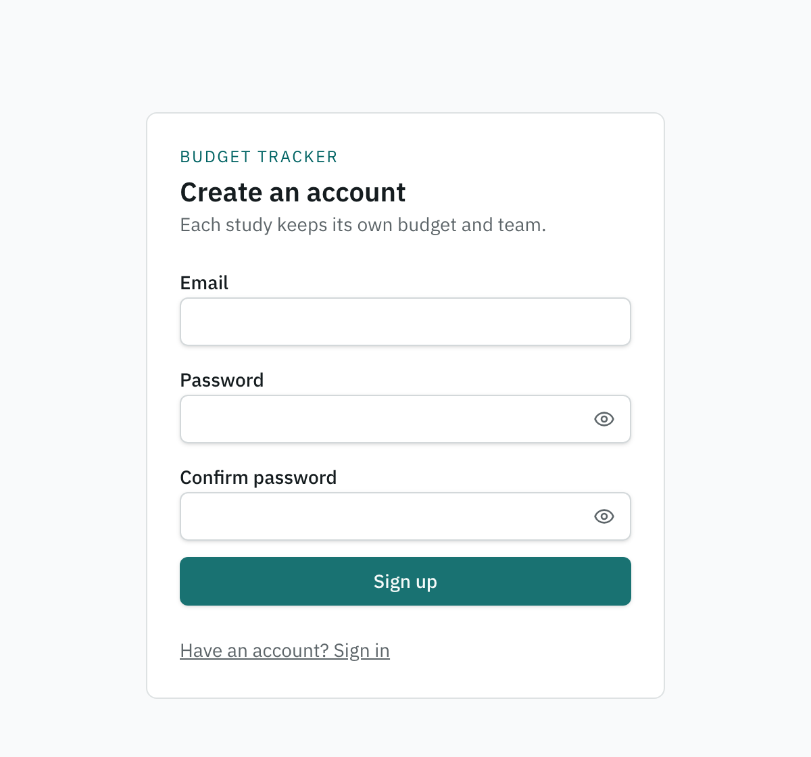

### 4.2 Sign in

- Enter your email and password.
- Click **Sign in**.
- Click the eye icon to show or hide the password while typing.

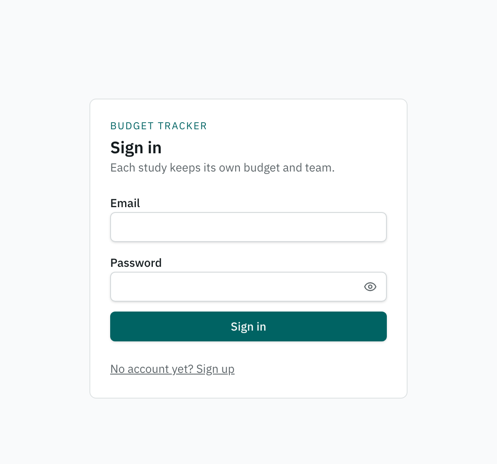

### 4.3 "Waiting for access"

- You see this screen if no study admin has added you yet.
- Send your sign-up email to a study admin and ask them to add you (see [11.7 Team](#117-team)).
- Once they have, reload the page.

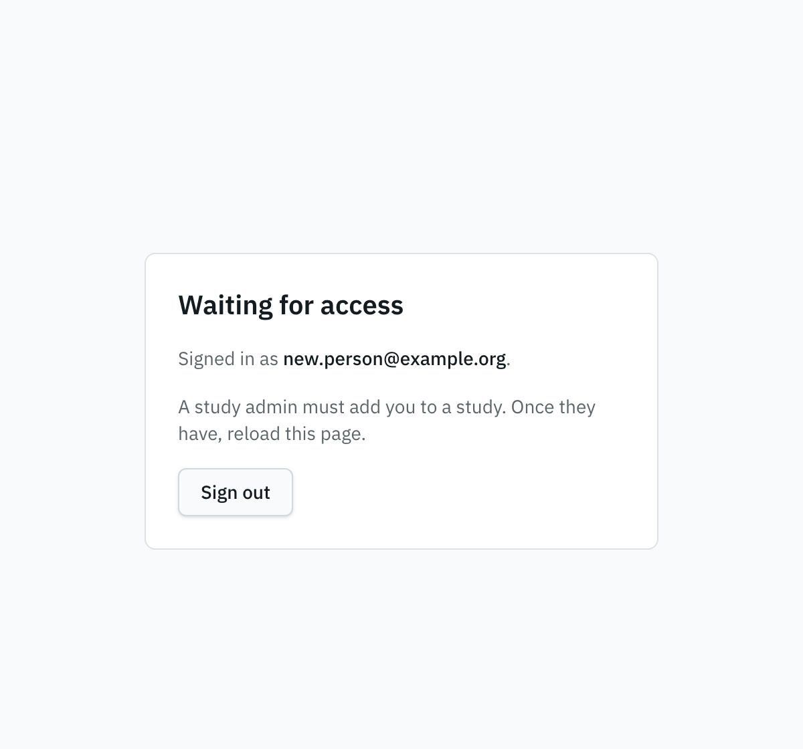

### 4.4 The welcome tour

- On your first visit a short tour opens. It walks through each page in about a minute.
- Click **Next** and **Back** to move, or the **X** to close.
- To see it again later, click the **?** icon at the top right.

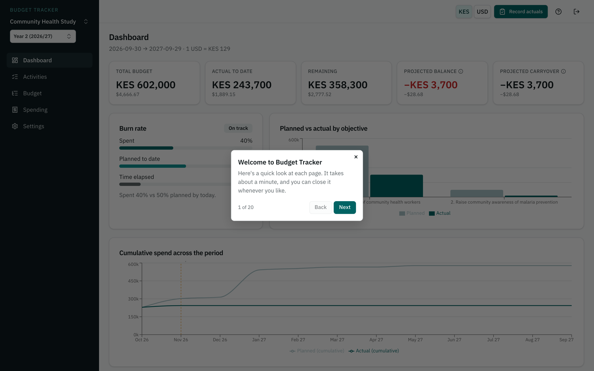

### 4.5 Sign out

- Click the exit icon at the far top right.
- Always sign out on shared computers.

## 5. Finding your way around

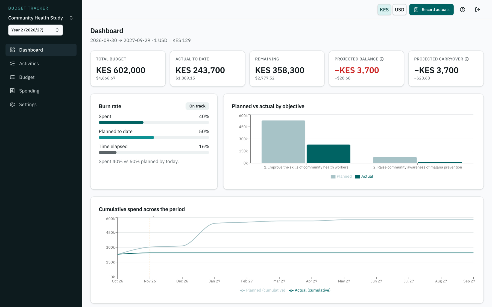

- **Left menu**: Dashboard, Activities, Budget, Spending, Settings.
- **Study name** (top of the left menu): click it to switch study, if you belong to more than one.
- **Year box** (under the study name): pick which year every page shows. The app remembers your choice.
  - A lock and "Closed" next to a year means it is read-only.
- **KES / USD** (top right): changes the currency amounts are shown in. Nothing is converted in the records; it is display only.
- **Record actuals** (top right): the quickest way to log spending. See [section 10](#10-recording-actual-spending).
- **?**: replays the tour.
- **Exit icon**: signs you out.

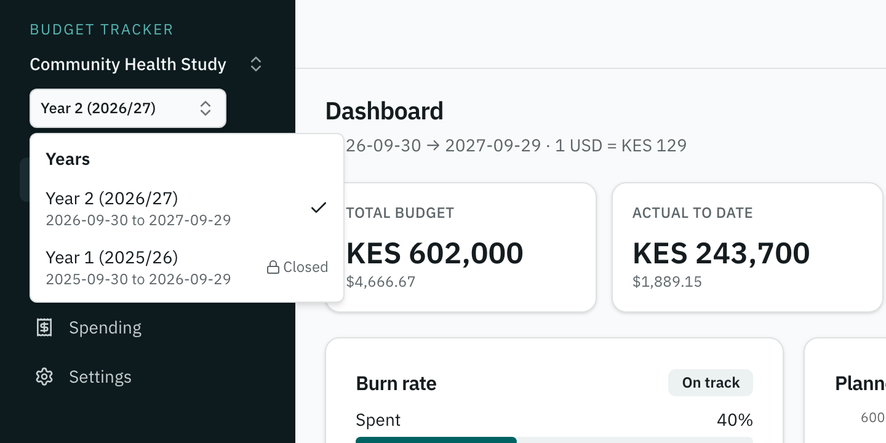

### On a phone

- The menu moves to the bottom of the screen.
- The year box and buttons stay at the top.

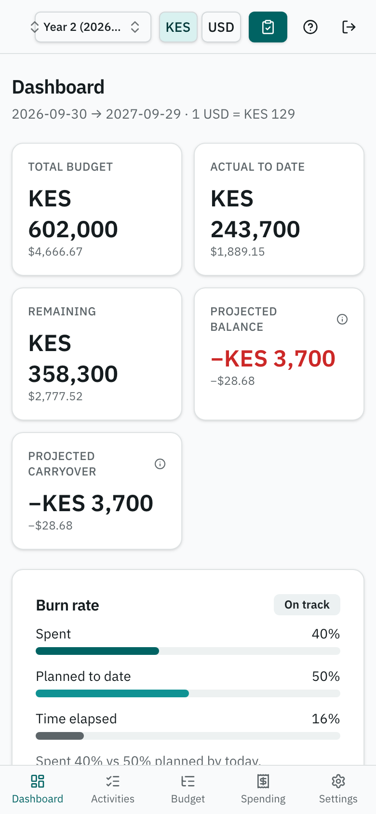

## 6. Dashboard

The dashboard shows where the budget stands today for the selected year.

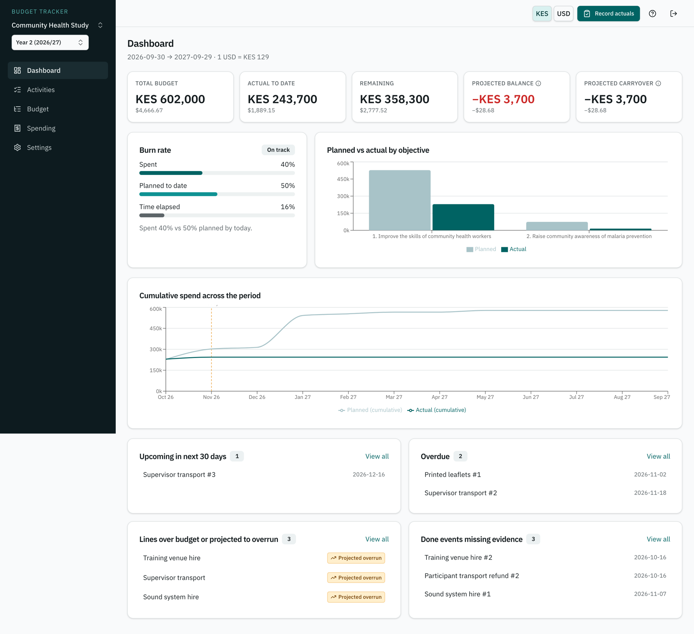

### 6.1 Headline figures (top row)

- **Total budget**: everything planned for the year.
- **Actual to date**: everything recorded as spent so far.
- **Remaining**: total budget minus actual to date.
- **Projected balance**: remaining money after the planned (not yet done) spending is also paid. Red means the plan will overspend.
- **Projected carryover**: unspent money expected to carry over to the next year.

### 6.2 Burn rate

- **Spent**: share of the budget already spent.
- **Planned to date**: share the plan expected to be spent by today.
- **Time elapsed**: share of the year that has passed.
- The label at the top sums this up: **On track** (within 10 points of plan), **Behind plan** (spending slower than planned) or **Ahead of plan** (spending faster than planned).

### 6.3 Charts

- **Planned vs actual by objective**: one pair of bars per objective.
- **Cumulative spend across the period**: planned and actual spending added up month by month. The dashed line marks today.

### 6.4 Work lists (bottom)

- **Upcoming in next 30 days**: spending planned soon.
- **Overdue**: planned date has passed but it is not marked done.
- **Lines over budget or projected to overrun**: lines that cost, or will cost, more than planned.
- **Done events missing evidence**: spending marked done with no receipt attached.
- Click **View all** to open the full list on the Spending page. Click an item to record it.

## 7. Activities (the workplan)

The Activities page holds the year's plan: objectives, the outcomes under them and the activities under those.

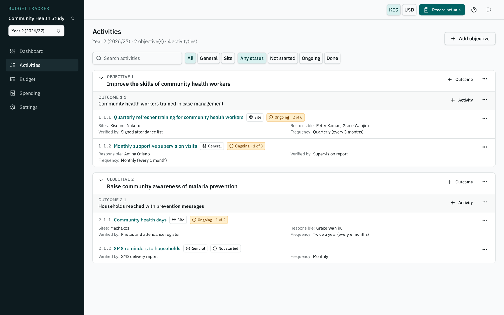

### 7.1 Find an activity

- Type in **Search activities**.
- Filter by kind: **All**, **General** or **Site**.
- Filter by status: **Any status**, **Not started**, **Ongoing**, **Done**.
- Each activity shows its status and how many rounds are done, such as "Ongoing · 2 of 6".

### 7.2 Add objectives, outcomes and activities

- **Add objective** (top right): enter an optional code (for example "1") and a title.
- **+ Outcome** on an objective row: adds an outcome under it.
- **+ Activity** on an outcome row: opens the activity form.
- Fill in the activity:
  - **Code (optional)** and **Title**.
  - **Kind**: General, or Site (happens at chosen sites).
  - **Output**: what the activity produces.
  - **Means of verification**: what proves it happened, for example "Signed attendance list".
  - **Frequency**: plain words such as "Quarterly".
  - **Repeats every** and **Unit**: for example every 3 months. Used to space out rounds.
  - **Notes**.
- Click **Add activity**.
- Two items at the same level with the same code show a warning. It is allowed, but check it is not a mistake.

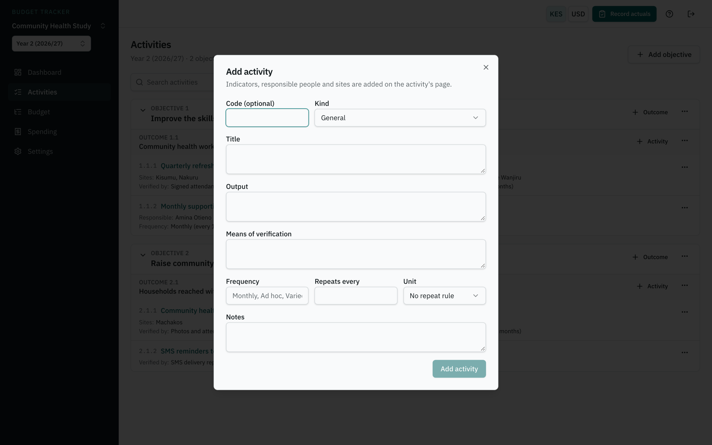

### 7.3 Edit, reorder or delete

- Use the **...** menu on any row.
- You cannot delete an activity (or the outcome or objective above it) while it has budget lines or rounds. Move the lines or delete the rounds first.

### 7.4 The activity page

Click an activity's title to open its page.

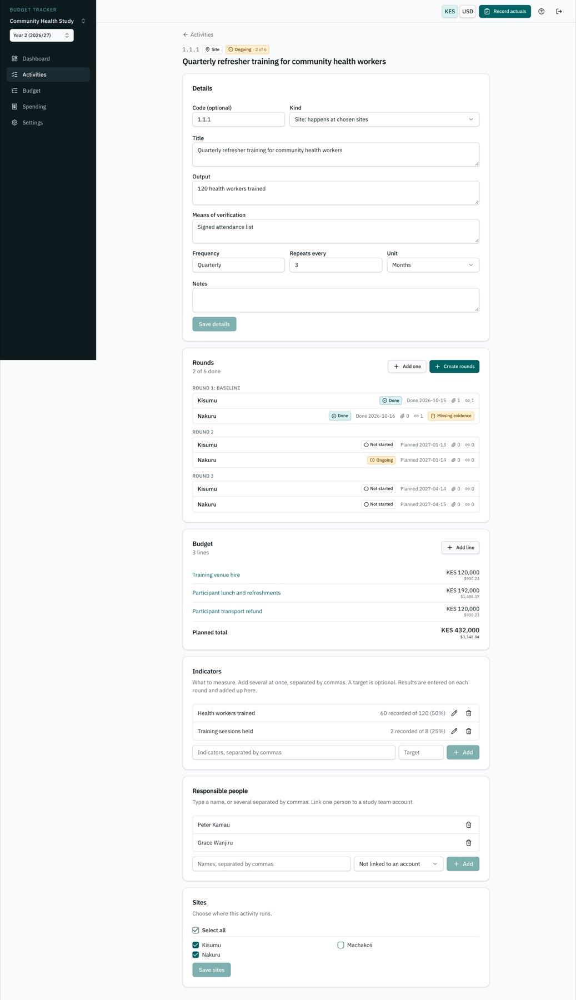

The page has these parts:

- **Details**: the same fields as the form. Click **Save details** after changes.
  - An activity's kind cannot change once it has rounds.
- **Rounds**: whether the activity took place (see 7.5).
- **Budget**: the budget lines under this activity and its planned total. "Unfunded" means no lines yet.
- **Indicators**: what you count, each with an optional target. Type several at once, separated by commas.
- **Responsible people**: who leads the activity. Can be linked to a team member's account.
- **Sites** (site activities only): tick where the activity runs, then save.

### 7.5 Rounds: tracking whether an activity happened

Rounds are separate from money. A round says "the training took place"; spending says "we paid for the venue".

**Create several rounds at once**

- Click **Create rounds**.
- Enter the **Number of rounds** and, if known, the **First date**.
- Leave **Space rounds by this activity's repeat rule** ticked to space dates automatically.
- Read the summary. It shows how many rounds will be created and how many already exist.
- Click **Create**.
- Running this again only adds missing rounds. Nothing is duplicated.

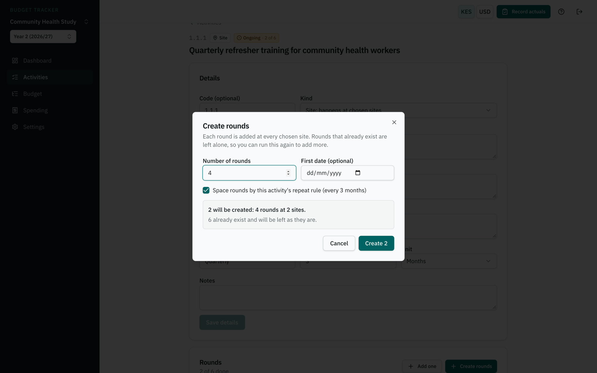

**Add a single round**

- Click **Add one** for extra or one-off work.

**Update a round**

- Click the round's row to open it.
- Set **Status**: Not started, Ongoing or Done.
- Done needs the **Date it took place**.
- Add **Notes** if useful.
- Under **Proof it happened**, upload files (PDF, JPG, PNG or XLSX, up to 10 MB). In an empty label box, press **Tab** to use the activity's means of verification as the label.
- Under **Indicator results**, enter the numbers for this round, for example 32 health workers trained.
- Under **Linked spending**, link spending records of the same activity if you want. Linking never changes amounts.
- Click **Save**.
- A round marked done without proof is saved, but flagged until proof is added.

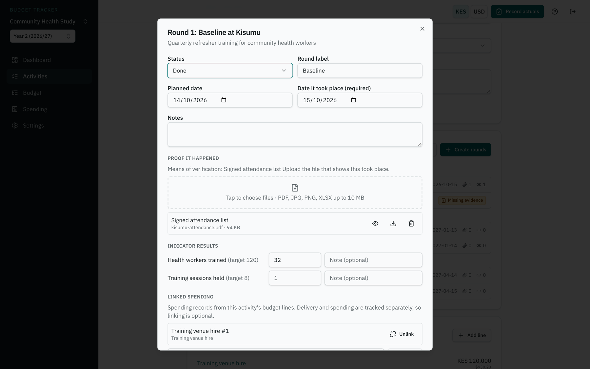

**Delete a round**

- Open the round and click **Delete round**. Only for a round that will no longer happen.
- Remove its proof files and unlink its spending first.
- The deletion is recorded in the audit log.

## 8. Budget

The Budget page lists every planned cost, grouped by objective, outcome and activity, with subtotals.

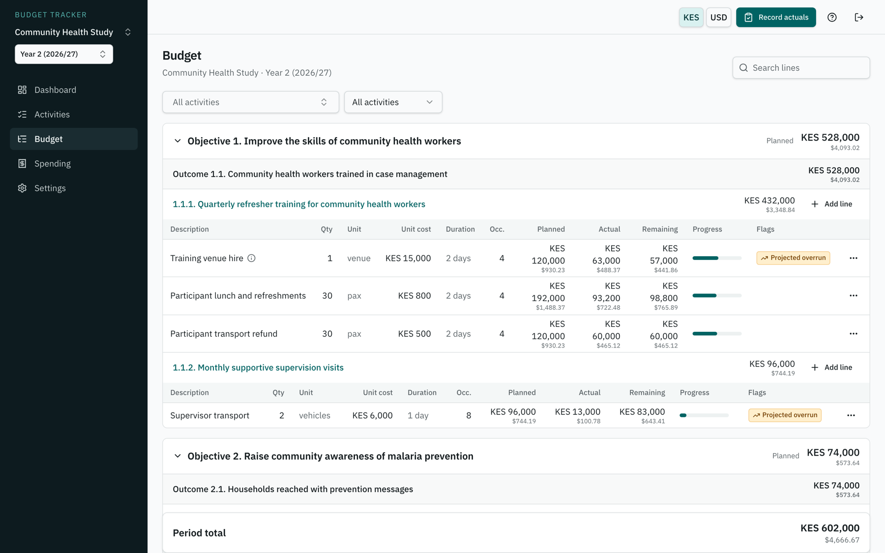

### 8.1 Reading a budget line

- **Qty** x **Unit cost** x **Duration** x **Occ.** (occurrences) = **Planned**.
  - Example: 30 people x KES 800 x 2 days x 4 times = KES 192,000.
  - Duration unit "one-off" always counts as 1.
- **Actual**: spent so far on this line.
- **Remaining**: planned minus actual.
- **Progress**: bar showing how much is used.
- **Flags**: warnings such as Projected overrun (see [section 13](#13-flags-and-statuses)).
- Hover the small "i" next to a description to read its justification.

### 8.2 Find lines

- **Search lines** box.
- **All activities** box: show one activity only.
- Funding filter: **All activities**, **With budget**, **Unfunded**.

### 8.3 Add a line

- Click **+ Add line** on the activity's row.
- Fill in:
  - **Activity** (already chosen).
  - **Group (optional)**: a heading to group lines.
  - **Description**.
  - **Quantity** and **Unit** (pick one or type your own, such as pax or sets).
  - **Unit cost (KES)**.
  - **Occurrences**: how many times it happens. Each occurrence becomes one spending record.
  - **Duration** and **Duration unit** (days, months, one-off or your own).
  - **Cost category**: Personnel, Travel, Supplies, Contractual or Other.
  - **Justification**: why the cost is needed.
- Check the calculation shown at the bottom, then click **Add line**.

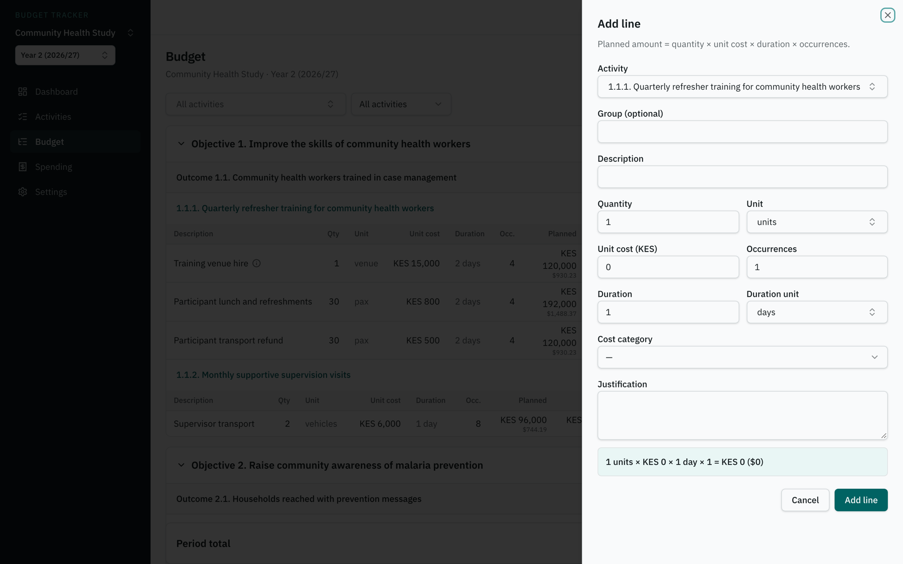

### 8.4 Line menu (...)

- **Edit**: change the line.
- **Move to another activity**: within the same year only.
- **Duplicate**: copy the line.
- **Delete**: asks you to confirm. Lines with completed spending warn you first.

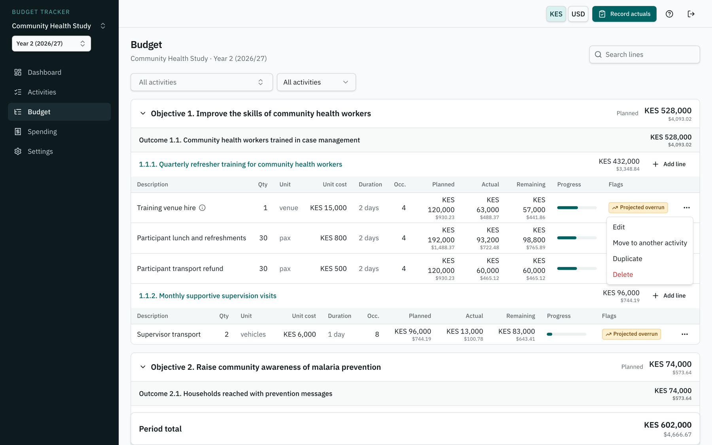

### 8.5 The line page

Click a line to open it.

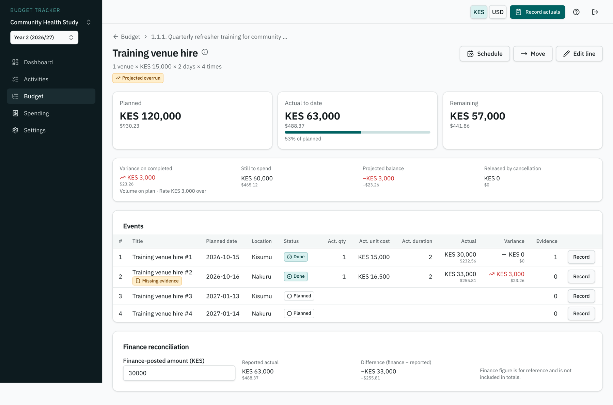

- Top figures: **Planned**, **Actual to date**, **Remaining**.
- Second row:
  - **Variance on completed**: difference between plan and actual on records already done.
  - **Still to spend**: planned cost of records not yet done.
  - **Projected balance**: what will be left if the rest goes to plan.
  - **Released by cancellation**: money freed by cancelled records.
- Buttons at the top: **Schedule** (set dates for all records), **Move**, **Edit line**.
- **Events** table: each spending record, with planned date, status, actual figures and evidence count. Click **Record** to log one.
- **Finance reconciliation**: type the amount finance has posted for this line. The app shows the difference against what the team reported. This figure is for checking only and does not change any totals.

### 8.6 Schedule dates for a whole line

- On the line page, click **Schedule**.
- Choose **Repeat** (every week, 2 weeks, month, 2 months, quarter or 6 months) and a **First date**, or **Pick each date** by hand.
- Done and cancelled records keep their dates.

## 9. Spending

Most day-to-day work happens here. Every spending record of the year is listed.

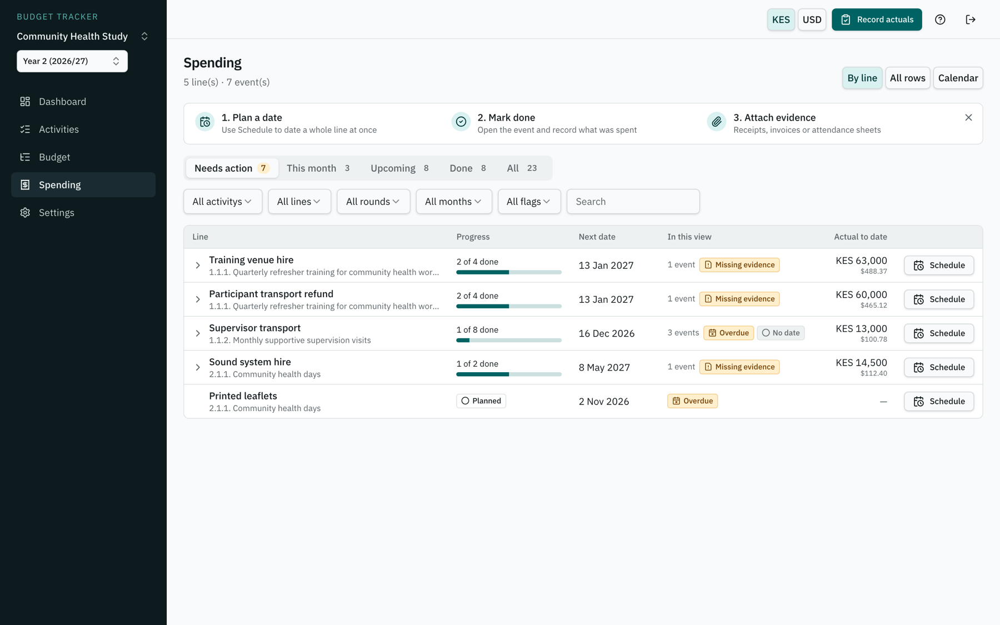

### 9.1 Three views

- **By line**: records grouped under their budget line, with progress and next date.
- **All rows**: one flat list you can sort.
- **Calendar**: records on a month calendar. Overdue items are outlined in red.

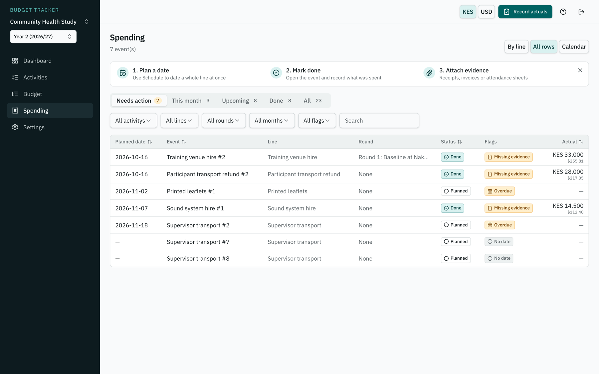

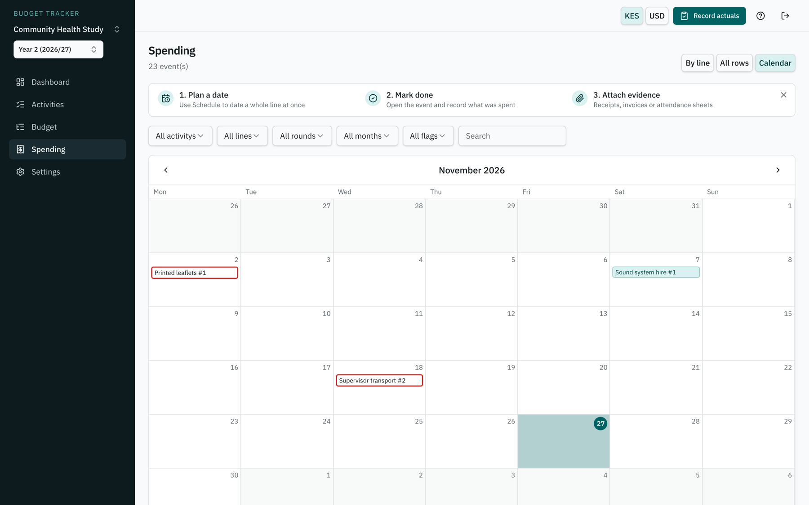

### 9.2 Tabs

- **Needs action**: overdue, no date yet, or missing evidence. Work through this tab to keep records clean.
- **This month**, **Upcoming**, **Done**, **All**.
- The number on each tab is how many records it holds.

### 9.3 Filters

- Narrow by **activity**, **line**, **round**, **month** or **flag**, or type in **Search**.

### 9.4 The three-step hint

- The bar at the top reminds you of the usual flow: **1. Plan a date**, **2. Mark done**, **3. Attach evidence**.
- Close it with the **X** if you no longer need it.

## 10. Recording actual spending

### 10.1 Open the form

Any of these works:

- Click **Record actuals** at the top right, type part of the name and pick the record.
- Click an item in a dashboard work list.
- Click **Record** on a line page.
- Click a record on the Spending page.

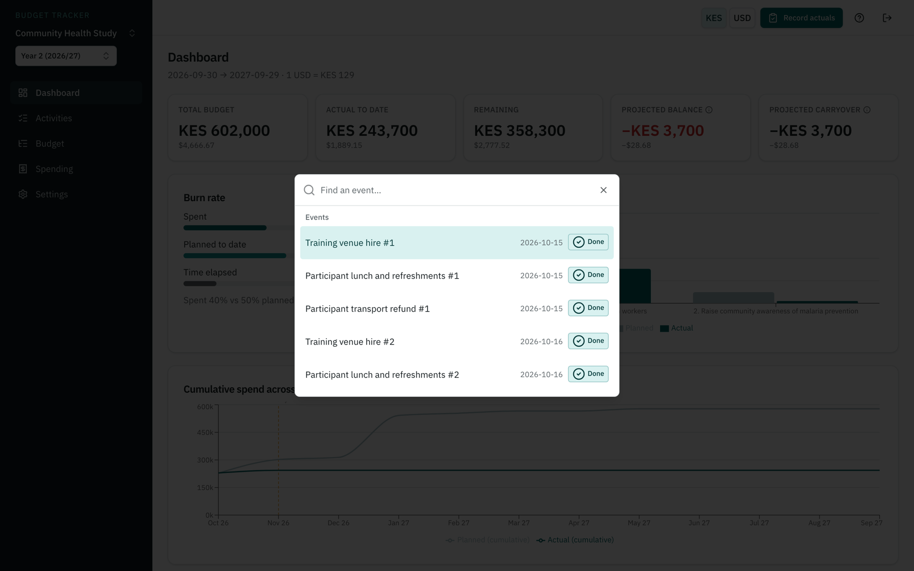

### 10.2 Fill in the form

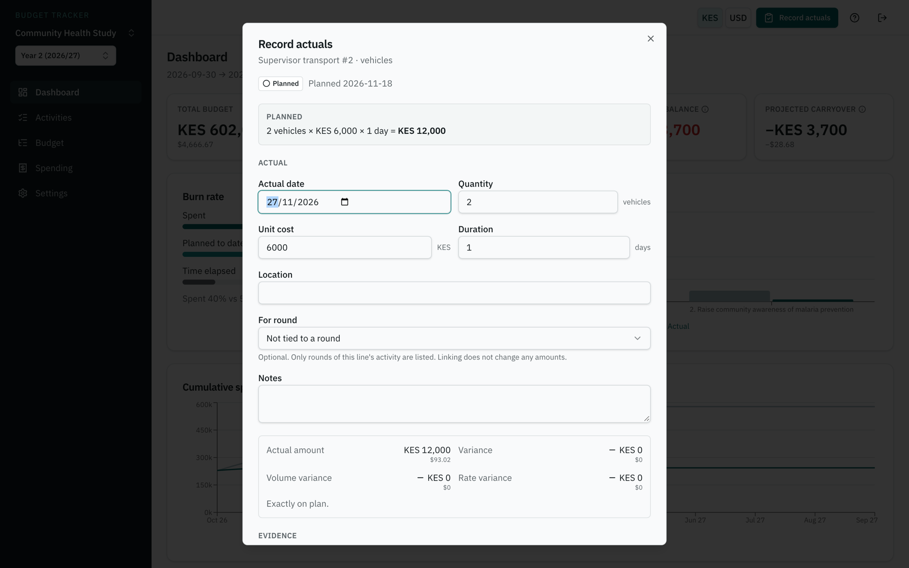

- The **Planned** box shows what was budgeted.
- Enter the **Actual date** (required).
- Enter actual **Quantity**, **Unit cost** and **Duration**. They start with the planned values.
- Add **Location** and **Notes** if useful.
- **For round**: optionally link this payment to a round of the same activity.
- Check the totals:
  - **Actual amount**: what was spent.
  - **Variance**: actual minus planned. Red means overspent.
  - **Volume variance**: part caused by a different quantity or duration.
  - **Rate variance**: part caused by a different unit cost.
- Under **Evidence**, add files (receipts, invoices, signed attendance lists). Give each a short label. Files upload when you save.
- Click **Mark done**. To keep the details without completing the record, click **Save without completing**.
- If the record is linked to a round, the app asks whether to mark that round done on the same date. It never does this without asking.

### 10.3 Saved without evidence?

- You can save without a file, but the record is flagged **Missing evidence** until you add one.
- Open the record again later and attach the file.

### 10.4 Cancel or reopen a record

- **Mark cancelled**: for spending that will not happen. Enter a reason. The planned money shows as released.
- **Reopen**: puts a done or cancelled record back to planned.

## 11. Settings

Settings has seven tabs.

### 11.1 Year

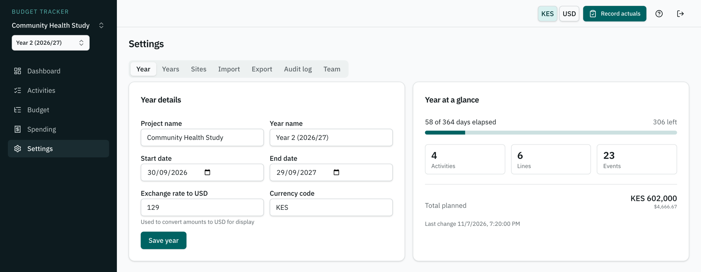

- **Year details**: project name, year name, start and end date, exchange rate to USD and currency code. Only admins can change dates, rate and currency.
- **Year at a glance**: days elapsed, counts of activities, lines and records, total planned and the last change.

### 11.2 Years (admins)

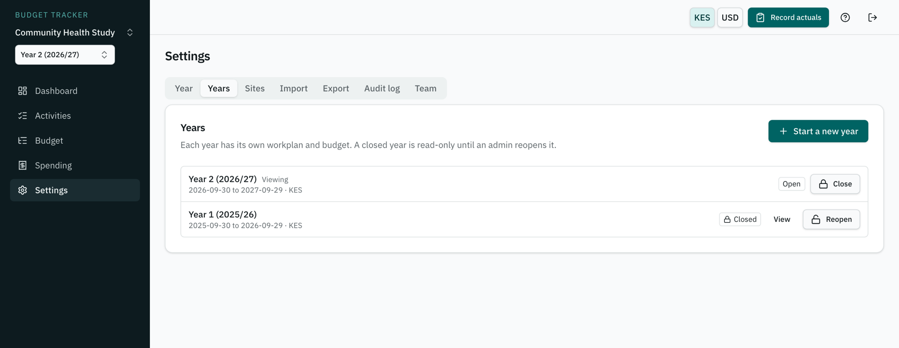

- Lists all years. "Viewing" marks the one on screen.
- **Open** or **View**: switch to that year.
- **Close**: locks the year. Nobody can add, edit or delete anything in it, including spending and files, until it is reopened.
- **Reopen**: unlocks it. Both actions are recorded in the audit log.

**Start a new year**

- Click **Start a new year**.
- **Start from**: a blank year, or the workplan of an earlier year.
  - Copying brings objectives, outcomes, activities, indicators, responsible people and sites.
  - Tick **Include budget lines** to copy lines too, each with fresh planned records.
  - Spending, actuals, finance figures, receipts, rounds and proof are never copied.
- Enter the **Year name**, **Start date**, **End date** (default 30 September to 29 September), **Exchange rate to USD** and **Currency**.
- Years cannot overlap.
- Click **Create year**.

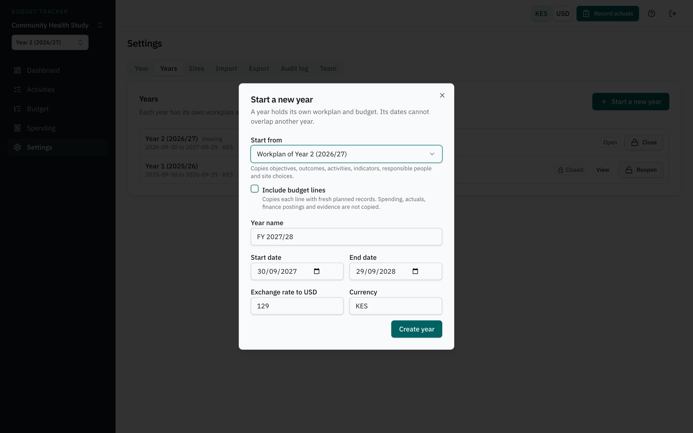

### 11.3 Sites (admins)

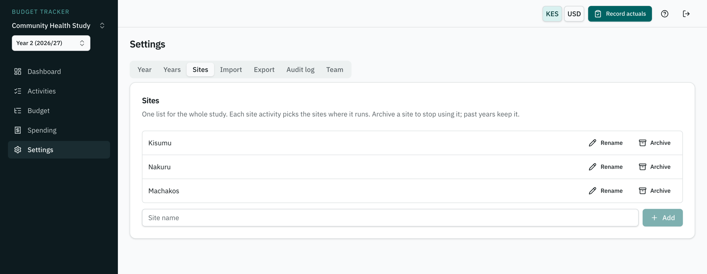

- One list of sites for the whole study.
- Type a name and click **Add**.
- **Rename** or **Archive** a site. Archived sites stop being offered, but past records keep them.

### 11.4 Import

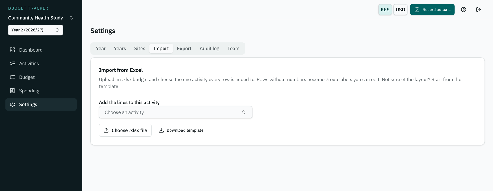

- Loads budget lines from an Excel (.xlsx) file.
- Click **Download template** if you are not sure of the layout.
- Choose the activity the lines go into.
- Click **Choose .xlsx file**.
- Check the preview. Rows without numbers become group headings. Fix any unit or number in the table.
- Confirm to import.
- Only works in an open year.

### 11.5 Export

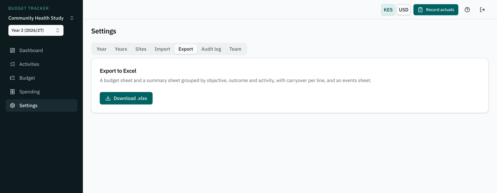

- Click **Download .xlsx**.
- The file has a budget sheet, a summary by objective, outcome and activity (with carryover per line) and a sheet of all spending records.

### 11.6 Audit log

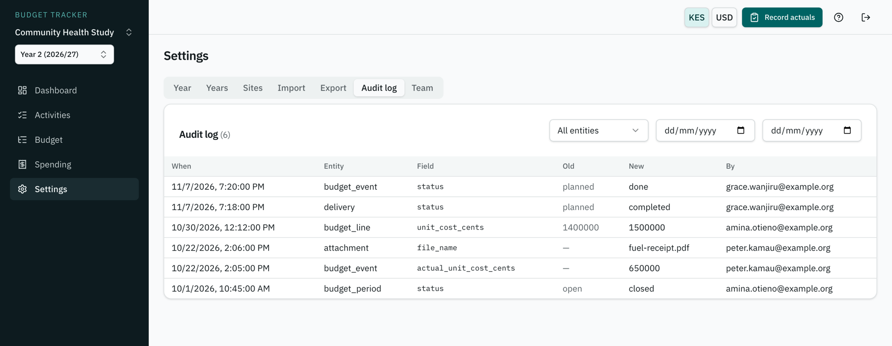

- Shows who changed what and when, with old and new values.
- Filter by type of item (**All entities**) and by date (**From**, **To**).
- Entries cannot be edited or removed.

### 11.7 Team

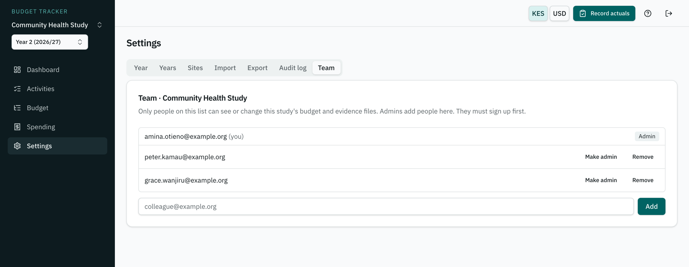

- Lists everyone in the study. "Admin" marks admins and "(you)" marks you.
- **Add someone** (admins): they must sign up first. Type their sign-up email and click **Add**.
  - "No account with that email yet" means they have not signed up.
- **Make admin** / **Remove admin**.
- **Remove**: takes the person out of the study.

## 12. Everyday tasks, step by step

**Log a payment that has just been made**

1. Click **Record actuals** (top right).
2. Search for the record and pick it.
3. Enter the actual date and figures.
4. Attach the receipt.
5. Click **Mark done**.

**Mark that a training took place**

1. Go to **Activities** and open the activity.
2. Under **Rounds**, click the round.
3. Set status to **Done** and enter the date.
4. Upload the attendance list and enter indicator results.
5. Click **Save**.

**Clean up before a monthly report**

1. Open **Spending**, tab **Needs action**.
2. For each overdue record: record it, change its date, or cancel it.
3. For each record with no date: open the line and use **Schedule**.
4. For each record missing evidence: open it and attach the file.
5. Go to **Settings, Export** and click **Download .xlsx**.

**Start next year's plan**

1. Admin: go to **Settings, Years**, click **Start a new year**.
2. Choose this year in **Start from**, tick **Include budget lines** if wanted.
3. Check the dates and exchange rate, then **Create year**.
4. When this year's work is finished, **Close** it.

**Bring in a new colleague**

1. Ask them to sign up with their work email.
2. Admin: go to **Settings, Team**, type their email, click **Add**.
3. Ask them to reload the page.

## 13. Flags and statuses

### Spending record status

| Status    | Meaning                                |
| --------- | -------------------------------------- |
| Planned   | Expected but not yet paid              |
| Done      | Paid and recorded                      |
| Cancelled | Will not happen; its money is released |

### Round status

| Status      | Meaning                    |
| ----------- | -------------------------- |
| Not started | Has not begun              |
| Ongoing     | Under way                  |
| Done        | Took place (date required) |

### Activity status (worked out automatically)

| Status      | Meaning                              |
| ----------- | ------------------------------------ |
| Not started | No round has started                 |
| Ongoing     | Some rounds started or done, not all |
| Done        | All rounds done                      |

### Flags

| Flag              | Meaning                                       | What to do                                       |
| ----------------- | --------------------------------------------- | ------------------------------------------------ |
| Over budget       | The line has already cost more than planned   | Review with finance; adjust the line if approved |
| Projected overrun | Spent plus still planned will exceed the line | Reduce future costs or revise the line           |
| Overdue           | Planned date has passed, still not done       | Record it, move the date, or cancel it           |
| No date           | No planned date set                           | Use **Schedule** on the line                     |
| Missing evidence  | Marked done with no file attached             | Open the record and attach the receipt           |

## 14. Common questions and problems

- **I signed in but see "Waiting for access".** A study admin has not added you yet. Send them your sign-up email.
- **I never got the confirmation email.** Check spam. Make sure you typed the email correctly, or sign up again.
- **Buttons are greyed out.** The year is closed. A grey bar with a lock says so at the top of every page. Choose another year, or ask an admin to reopen it.

  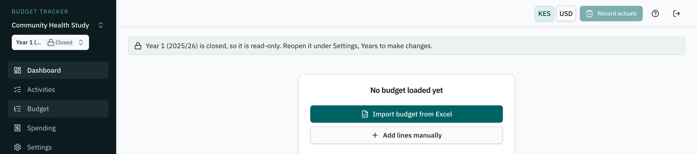

- **The top of the screen says "This study has no year yet".** An admin must create the first year (Settings, Years).
- **I can't delete an activity.** It has budget lines or rounds. Move the lines to another activity and remove the rounds first.
- **I can't delete a round.** Remove its proof files and unlink its spending first.
- **I can't move a line to another year.** Lines only move between activities of the same year.
- **The USD figure looks wrong.** USD uses the exchange rate set for the year (Settings, Year). Ask an admin to check it.
- **The import says "No budget rows found".** The sheet needs a header row with a Description column. Start from the template.
- **I'm on the wrong study or year.** Use the study name and year box at the top of the left menu (top of the screen on a phone).
- **Who changed this figure?** Check Settings, Audit log.
